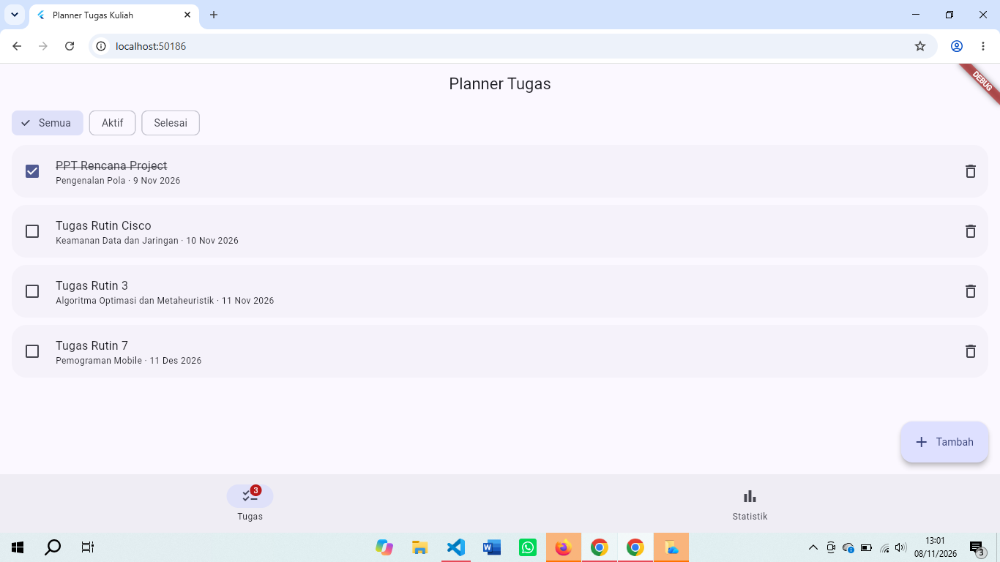
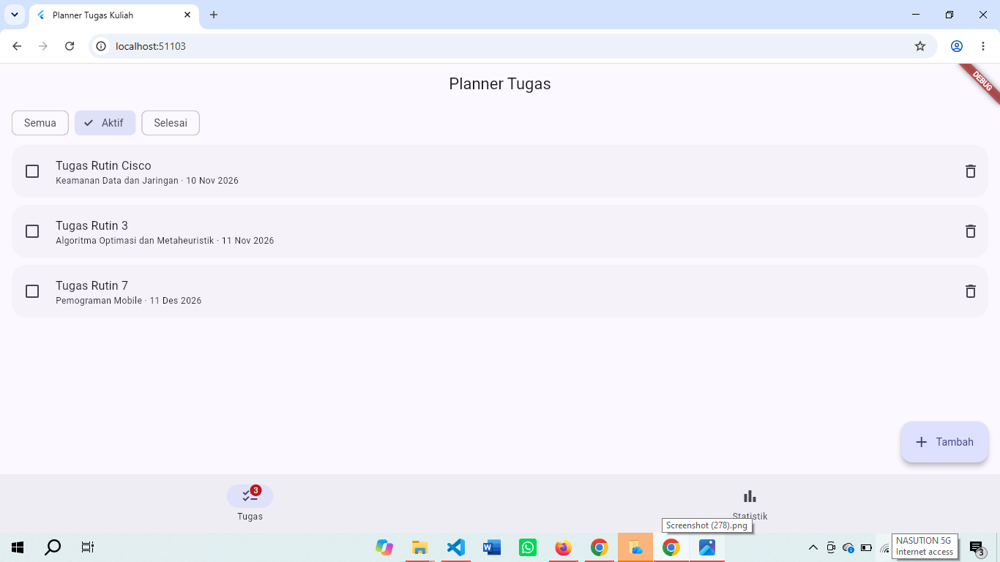
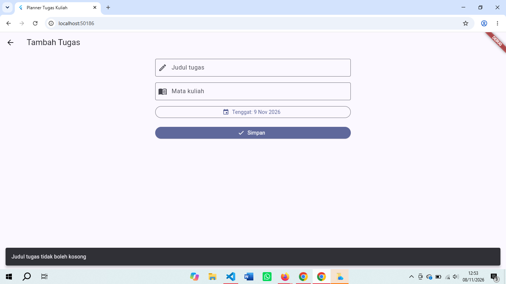
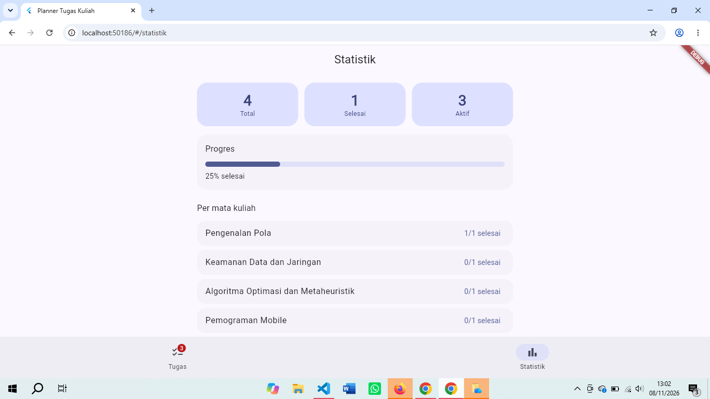

# pm-pertemuan-07-4241250005

Tugas Rutin 7 - Pemrograman Mobile: Planner Tugas Kuliah

- Nama: Nayla Anjani Nasution
- NIM: 4241250005
- Kelas: PSIK 24C

Aplikasi Flutter untuk mencatat tugas kuliah: menambah tugas, menandai selesai, menghapus, menyaring berdasarkan status, dan melihat statistik. Data tugas disimpan di memori, sehingga kembali kosong setiap aplikasi dijalankan ulang.

## Cara Menjalankan

```
flutter pub get
flutter run -d chrome
flutter test
```

Paket yang dipakai: `material_ui`, `go_router`, dan `provider`.

## Tangkapan Layar

Daftar tugas dengan satu tugas selesai. Badge pada tab Tugas menunjukkan jumlah tugas yang masih aktif:



Filter Aktif hanya menampilkan tugas yang belum selesai:



Form tambah tugas. Judul kosong ditolak dengan pesan kesalahan:



Halaman statistik:



## Halaman dan Rute

| Rute | Halaman | Isi |
|---|---|---|
| `/` | `HalamanDaftar` | daftar tugas, `FilterChip`, centang, hapus |
| `/tambah` | `HalamanTambah` | form judul, mata kuliah, dan tenggat |
| `/statistik` | `HalamanStatistik` | total, selesai, aktif, persentase, rekap per mata kuliah |

Rute `/` dan `/statistik` berada di dalam kerangka navigasi (`StatefulShellRoute` dengan `NavigationBar`). Rute `/tambah` dibuka dengan `context.push` di atas kerangka itu sebagai halaman penuh. Alamat yang tidak dikenal menampilkan halaman 404.

## Diagram Letak State

```
ChangeNotifierProvider<PlannerModel>      <- state bersama (Provider)
└─ AplikasiPlanner (MaterialApp.router)
   ├─ KerangkaNavigasi                    select: jumlahAktif -> Badge
   │  ├─ HalamanDaftar (Stateful)         watch: daftar tugas
   │  │  ├─ _filter                       state lokal (setState)
   │  │  └─ KartuTugas                    read: tandaiSelesai(), hapus()
   │  └─ HalamanStatistik (Stateless)     watch: total, selesai, persen
   └─ HalamanTambah (Stateful)            read: tambah()
      └─ _judul, _mataKuliah, _tenggat    state lokal (controller + setState)
```

| State | Letak | Jenis | Alasan |
|---|---|---|---|
| Filter Semua, Aktif, Selesai | `_HalamanDaftarState` | lokal (`setState`) | hanya dipakai satu halaman dan tidak perlu diketahui halaman lain |
| Isi form (judul, mata kuliah, tenggat) | `_HalamanTambahState` | lokal (controller dan `setState`) | hanya hidup selama form terbuka |
| Daftar tugas | `PlannerModel` | bersama (Provider) | dipakai halaman daftar, halaman statistik, dan badge navigasi |

Aturan yang dipakai: jika state hanya dipakai satu widget, cukup `setState`. Jika dipakai beberapa halaman di cabang berbeda, state dipindah ke atas pohon dan dibagikan lewat Provider.

## Cara Halaman Mengakses State Bersama

| API | Dipakai di | Alasan |
|---|---|---|
| `context.watch<PlannerModel>()` | `build()` halaman daftar dan statistik | halaman harus digambar ulang setiap data berubah |
| `context.read<PlannerModel>()` | callback centang, hapus, dan simpan | hanya memanggil method, tidak perlu mendengarkan |
| `context.select((m) => m.jumlahAktif)` | `KerangkaNavigasi` (badge) | kerangka hanya dibangun ulang bila jumlah aktif berubah, bukan setiap ada perubahan data |

## Alasan Memilih Provider

Provider dipilih dibanding Cubit/BLoC karena aplikasi ini kecil dan hanya punya satu daftar tugas dengan tiga operasi (`tambah`, `tandaiSelesai`, `hapus`). Pertimbangannya:

- **Kurva belajar dan boilerplate.** Provider cukup memakai satu class `ChangeNotifier` dan `notifyListeners()`. Cubit membutuhkan class state terpisah, `emit()`, dan paket `flutter_bloc`.
- **Kebutuhan aplikasi.** Keunggulan Cubit/BLoC (state immutable, alur event yang bisa dilacak) lebih terasa pada aplikasi besar dengan alur yang rumit. Untuk planner ini, itu belum diperlukan.
- **Kemudahan uji.** `PlannerModel` tidak bergantung pada widget (hanya `flutter/foundation`), sehingga logikanya bisa diuji langsung dengan unit test.
- **Kekurangan yang disadari.** Provider memakai state yang bisa diubah (mutable) dan pemberitahuan manual lewat `notifyListeners()`. Jika lupa memanggilnya, tampilan tidak berubah. Pada aplikasi yang lebih besar, Cubit lebih aman karena setiap perubahan menghasilkan objek state baru.

`TugasKuliah` sendiri dibuat immutable (perubahan lewat `copyWith`), jadi sebagian manfaat state immutable tetap didapat.

## Lifecycle dan Pembersihan Resource

Pada `HalamanTambah`:

- `initState()` membuat `TextEditingController` untuk judul dan mata kuliah, dijalankan sekali.
- `dispose()` memanggil `dispose()` pada kedua controller agar tidak terjadi kebocoran memori.
- Setelah `await showDatePicker(...)`, kode memeriksa `mounted` sebelum memanggil `setState`, karena halaman bisa saja sudah ditutup selama menunggu.

## Penanganan Error

`PlannerModel.tambah()` melempar `FormatException` bila judul atau mata kuliah kosong. Halaman form menangkapnya dengan `try ... on FormatException catch` lalu menampilkan pesannya di `SnackBar`. Model hanya memeriksa dan melapor, sedangkan halaman yang memutuskan cara menampilkannya. `tandaiSelesai()` dan `hapus()` mengabaikan id yang tidak ada sehingga tidak